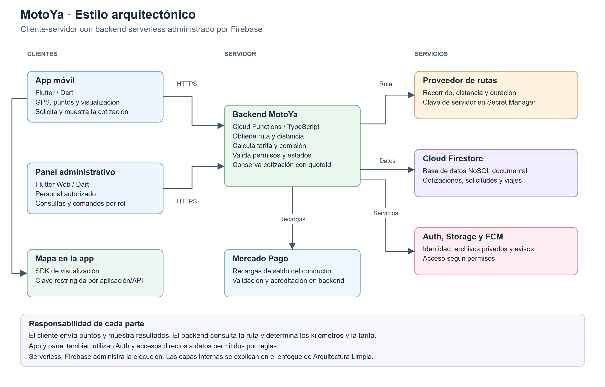

# MotoYa | Sprint 01
## Documentación técnica y diseño de la solución

**Universidad Nacional de San Cristóbal de Huamanga**  
Escuela Profesional de Ingeniería de Sistemas

| Dato | Información |
|---|---|
| Curso | Arquitectura de Software |
| Docente | Ing. Lizbeth Jaico Quispe |
| Estudiante | Ayala Arango, Alvaro Ademir |
| Proyecto | MotoYa: transporte en motolineal en Huamanga, Ayacucho |
| Entregable | Sprint 01: documentación técnica del proyecto |
| Naturaleza | Especificación del diseño que guía la programación e implementación |

## Problemática

En Huamanga, Ayacucho, quienes viven lejos de un paradero de motos deben caminar o buscar una unidad disponible para trasladarse, lo que dificulta organizar su tiempo. Además, al abordar un servicio informal no siempre cuentan con información previa del conductor, un precio acordado o herramientas para compartir el recorrido. El proyecto identifica la necesidad de facilitar el transporte en motolineal con recojo en el lugar indicado y mecanismos de identificación y seguimiento que ayuden al pasajero a coordinar su viaje.

## Solución y visión

MotoYa conecta pasajeros con conductores de motolineal para coordinar el recojo, acordar el precio y seguir el viaje. El pasajero solicita desde su vivienda u otro punto dentro de cobertura y consulta la llegada del conductor mientras termina de prepararse. Debe estar listo cuando llegue la moto.

La visión del proyecto es facilitar el acceso al transporte y la coordinación del recojo mediante una experiencia sencilla y herramientas de identificación, PIN, seguimiento, compartir viaje y SOS.

## Objetivos

| Objetivo | Aporte del sistema |
|---|---|
| Facilitar el acceso al transporte | Solicitar recojo sin desplazarse primero al paradero. |
| Coordinar al pasajero y conductor | Mostrar ubicación y estimación de llegada. |
| Acordar condiciones del viaje | Comparar ofertas y confirmar conductor y precio. |
| Apoyar la seguridad | Identificación, PIN, compartir y registro de alertas. |
| Gestionar la operación | Panel con roles, revisión de conductores, recargas y atención. |

## Diseño de la solución

| Parte | Responsabilidad |
|---|---|
| App móvil Flutter | Interfaz, GPS, selección de puntos y visualización de resultados. |
| Panel Flutter Web | Administración y atención según permisos. |
| Backend Cloud Functions | Autorizar operaciones, consultar rutas, calcular distancia y tarifa, controlar estados y dinero. |
| Cloud Firestore | Guardar cotizaciones, solicitudes, perfiles, viajes y movimientos como documentos. |
| Firebase Auth, Storage y FCM | Identidad, archivos privados y notificaciones. |
| Proveedor cartográfico | Proporcionar recorridos y estimaciones al backend; mostrar el mapa en la app según el SDK. |

El estilo es **cliente-servidor**, con backend **serverless administrado**. El enfoque interno es **Arquitectura Limpia**. La distancia utilizada para la tarifa procede de una consulta del servidor al proveedor de rutas. El cliente solicita y muestra una cotización identificada por `quoteId`; sus kilómetros o precios calculados localmente no son autoritativos.

El pasajero paga directamente al conductor con efectivo, Yape o Plin. Las recargas pertenecen al saldo del conductor y se acreditan mediante una operación autorizada del backend. Las claves de consultas del servidor se conservan en Secret Manager; la clave del SDK móvil tiene restricciones de aplicación y API.

Esta documentación define el comportamiento y las decisiones del sistema. Sus medidas son criterios de aceptación para verificar la implementación, no resultados de pruebas de operación.

## Índice del entregable

| Bloque | Documento |
|---|---|
| 1.1 | [Actores](docs/01-analisis-de-sistema/01-actores.md) |
| 1.2 | [Historias de usuario](docs/01-analisis-de-sistema/02-historias-del-usuario.md) |
| 1.3 | [Requisitos funcionales](docs/01-analisis-de-sistema/03-requisitos-funcionales.md) |
| 1.4 | [Atributos de calidad](docs/01-analisis-de-sistema/04-atributos-de-calidad.md) |
| 1.5 | [Restricciones](docs/01-analisis-de-sistema/05-restricciones.md) |
| 1.6 | [Drivers arquitectónicos](docs/01-analisis-de-sistema/06-drivers-arquitectonicos.md) |
| 1.7 | [Decisiones arquitectónicas](docs/01-analisis-de-sistema/07-decisiones-arquitectonicas.md) |
| 1.8 | [Escenarios de calidad](docs/01-analisis-de-sistema/08-escenarios-atributos-calidad.md) |
| 2.1 | [Arquitectura inicial y evolución](docs/02-arquitectura-software/arquitectura-inicial.md) |
| 2.2 | [Estilo arquitectónico](docs/02-arquitectura-software/estilo-arquitectonico.md) |
| 2.3 | [Enfoque arquitectónico: Arquitectura Limpia](docs/02-arquitectura-software/enfoque-arquitectonico.md) |
| 2.4 | [Componentes arquitectónicos](docs/02-arquitectura-software/componentes-arquitectonicos.md) |
| 3.1 | [Diseño interno: búsqueda y negociación](docs/03-diseno-de-software/diseno-interno/diseno-interno-de-modulos.md) |
| 3.2 | [Patrones de diseño](docs/03-diseno-de-software/diseno-interno/patrones-de-diseno.md) |
| 3.3 | [Principios de diseño: SOLID](docs/03-diseno-de-software/diseno-interno/principios-de-diseno.md) |
| 4.1 | [Nivel 1: contexto del sistema](docs/04-modelo-c4/nivel1-contexto.md) |
| 4.2 | [Nivel 2: contenedores](docs/04-modelo-c4/nivel2-contenedores.md) |
| 4.3 | [Nivel 3: componentes de la app](docs/04-modelo-c4/nivel3-componentes.md) |
| 4.4 | [Nivel 4: código de búsqueda y ofertas](docs/04-modelo-c4/nivel4-codigo.md) |
| 5.1 | [Modelo de datos y estados](docs/05-anexos/modelo-de-datos-y-estados.md) |
| 5.2 | [Reglas de negocio relevantes](docs/05-anexos/reglas-de-negocio.md) |
| 5.3 | [Límites de confianza y controles](docs/05-anexos/limites-y-pendientes.md) |
| 5.4 | [Trazabilidad y validación](docs/05-anexos/trazabilidad-y-validacion.md) |
| 5.7 | [Guía breve para exponer](docs/05-anexos/guia-de-exposicion.md) |
| Anexo | [Alcance y plan del sprint](docs/05-anexos/alcance-y-plan-del-sprint.md) |
| Tecnología | [Ejemplo ejecutable de Arquitectura Limpia en Dart](tecnologia/boilerplate-clean-architecture/README.md) |
| Diagrama | [Esquema interactivo de las capas](img/arquitectura-limpia.html) |

## Diagrama general de MotoYa

El backend calcula el recorrido, la distancia y la tarifa. App y panel usan identidad y accesos a datos sujetos a permisos. Las operaciones financieras y los cambios críticos de estado pertenecen al servidor.

## Alcance del repositorio

La organización sigue la [guía académica de la docente](https://github.com/devlizbethjaico/Marketplace-arquitSoft-02): análisis, arquitectura, diseño y modelo C4. `tecnologia/` contiene un ejemplo didáctico de contratos y adaptadores, separado de la especificación completa de MotoYa.
