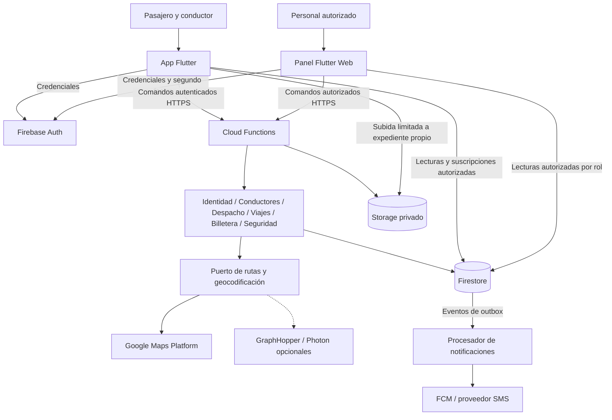

# Arquitectura inicial de MotoYa

Propongo una arquitectura cliente-servidor sobre servicios administrados, con módulos de negocio y separación por capas. El teléfono captura acciones y presenta resultados; el servidor decide estados, asignación, tarifas, saldo y sanciones.

## Flujo principal

1. Auth verifica la identidad; la función comprueba cuenta habilitada, permisos y datos de entrada.
2. Cotización consulta una ruta válida y guarda una instantánea de precios.
3. Despacho filtra conductores y distribuye ofertas vigentes.
4. Aceptar crea el viaje con reserva de comisión y disponibilidad de ambos participantes en una transacción.
5. Viajes controla llegada, PIN, seguimiento y cierre. Finalizar debita una sola vez y libera la reserva.
6. Los avisos se procesan después de persistir los eventos. La app recupera el estado desde Firestore si un aviso se pierde.

## Límite de confianza

El SDK móvil puede leer lo permitido por reglas y subir documentos propios bajo restricciones. No puede escribir directamente estados, saldo, permisos, aprobaciones o tarifas. Las funciones que usan credenciales de servicio deben validar autorización explícitamente, además de las reglas del acceso cliente.

Los mapas de visualización no equivalen al cálculo de tarifa. El SDK dibuja; el adaptador de rutas obtiene distancia validada. No se incorpora procesamiento de pagos de viajes.
