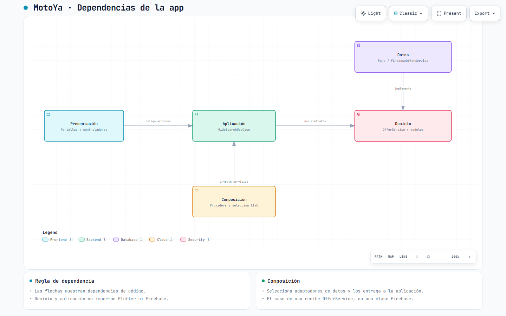

# Enfoque arquitectónico: Arquitectura Limpia

La regla central es que las reglas internas no dependan de pantallas, Firebase o proveedores externos. Un caso de uso conoce un contrato; una implementación externa cumple ese contrato.

| Capa | Carpeta real en la app | Responsabilidad | Ejemplo |
|---|---|---|---|
| Dominio | app/lib/domain/ | Modelos, reglas y contratos | OfferService, RideRequest, FareRules |
| Aplicación | app/lib/application/ | Coordinar acciones y resultados | RideSearchUseCase |
| Presentación | app/lib/presentation/ | Pantallas y estado de interfaz | RideSearchController |
| Datos / infraestructura | app/lib/data/ | Firebase, HTTP y persistencia | FirebaseOfferService, FakeOfferService |
| Composición | app/lib/composition/ | Crear y seleccionar dependencias | offerServiceProvider |
| Configuración | app/lib/config/ | Opciones de arranque y entorno | STANDALONE_DEMO y configuración runtime |

El panel emplea las mismas capas principales. En el backend existen domain, application, infrastructure y presentation. Sus puertos de aplicación residen en application/ports.ts: pertenecen al núcleo que los necesita, no a Firebase. No es necesario forzar todos los puertos al dominio para que la dependencia esté invertida.

El diagrama complementario [MotoYa: dependencias de la app](../../img/arquitectura-limpia.html) muestra las dependencias principales. Composición también conoce adaptadores concretos para seleccionarlos; las flechas de ejecución y las dependencias de código no son lo mismo. El contenido está en español; los controles fijos del visor Archify utilizan inglés.

---

[Volver al índice](../../README.md)
