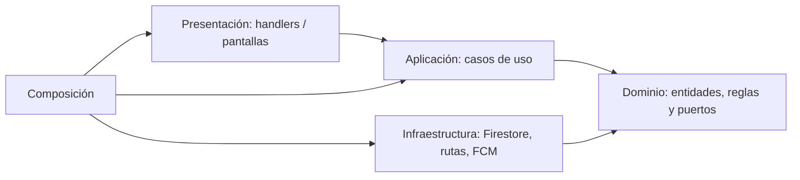

# Enfoque: Clean Architecture y puertos/adaptadores

## Regla de dependencia

Las flechas representan dependencias de código. En ejecución, el caso de uso llama a una interfaz cuya implementación pertenece a infraestructura. La inversión de dependencias evita que el dominio importe SDKs.

| Capa | Backend propuesto | App propuesta | Restricción |
|---|---|---|---|
| Presentación | Handlers de comandos, validación de forma y errores | Pantallas y controladores Riverpod | No decide comisión ni autorización de negocio |
| Aplicación | AceptarOferta, FinalizarViaje, ConfirmarRecarga | SolicitarViaje, observar viaje, enviar comando | Depende de puertos, no de proveedores concretos |
| Dominio | Viaje, Dinero, PolíticaTarifa, estado y reglas | Modelos de lectura y contratos de servicios | No depende de Firebase, Flutter ni HTTP |
| Infraestructura | Repositorios Firestore, GoogleRoutesAdapter, FcmAdapter | Adaptadores de Auth, funciones, ubicación y almacenamiento | Traduce formatos externos |
| Composición | Inicialización e inyección de implementaciones | Providers y configuración de entorno | Único punto que conoce implementaciones concretas |

## Ejemplo

`FinalizarViaje` recibe `CierreViajePort`, `PoliticaComision` y `Reloj`. El caso de uso autoriza al conductor y solicita un cierre atómico. El adaptador Firestore aplica todas las lecturas y escrituras en una transacción. Un adaptador en memoria sirve para pruebas del dominio, pero no demuestra el comportamiento real de concurrencia de Firestore.

No se comparte a ciegas lógica monetaria entre Dart y TypeScript. La respuesta del servidor contiene los montos definitivos; cualquier cálculo local es una vista preliminar, sin autoridad para cobrar.
