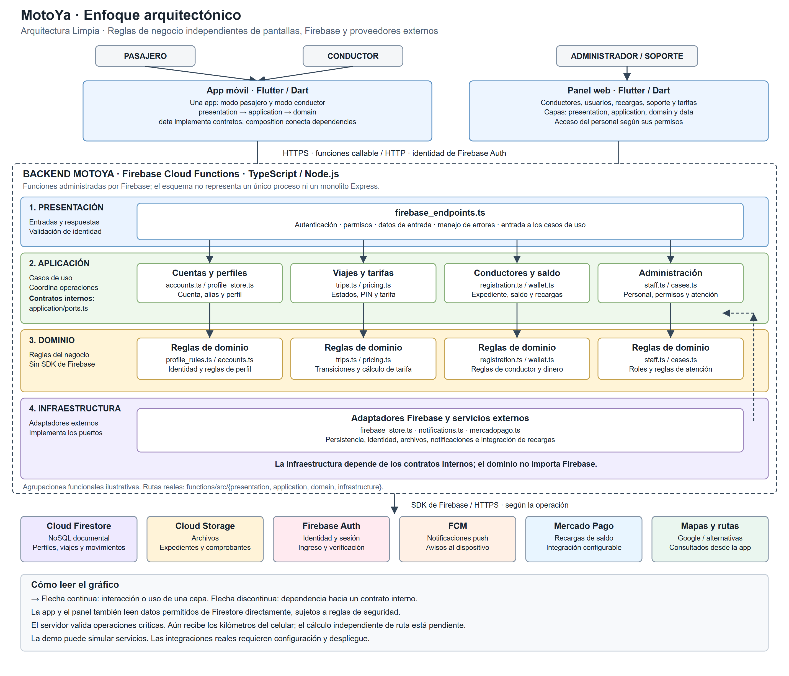

# Enfoque arquitectónico: Arquitectura Limpia

La regla central es que las reglas internas no dependan de pantallas, Firebase o proveedores externos. Un caso de uso conoce un contrato; una implementación externa cumple ese contrato.

**El enfoque describe la organización interna del código.** Se complementa con el [estilo cliente-servidor](estilo-arquitectonico.md), que explica la comunicación entre la app, el panel y el backend.

## Gráfico detallado de Arquitectura Limpia

[Ver imagen completa](../../img/enfoque-arquitectonico-motoya.png) · [Versión vectorial ampliable](../../img/enfoque-arquitectonico-motoya.svg)

El gráfico detalla las capas del backend y resume la organización de la app y el panel. Sus columnas agrupan responsabilidades para explicarlas; no representan microservicios independientes. Los archivos señalados pertenecen a las carpetas del backend indicadas en el esquema.

| Capa del backend | Qué hace | Carpeta |
|---|---|---|
| Presentación | Recibe solicitudes y valida identidad, permisos y entradas. | `functions/src/presentation/` |
| Aplicación | Coordina casos de uso y define los puertos que necesita. | `functions/src/application/` |
| Dominio | Contiene reglas de negocio independientes de Firebase. | `functions/src/domain/` |
| Infraestructura | Implementa conexiones con Firebase y proveedores externos. | `functions/src/infrastructure/` |

Las flechas hacia el dominio muestran el uso de las reglas internas. La infraestructura implementa los contratos de `application/ports.ts`: la dependencia de código apunta a los contratos internos, aunque durante la ejecución se invoque un adaptador externo. Las reglas de negocio no dependen del SDK de Firebase.

**Para exponer:** «Arquitectura Limpia separa responsabilidades. Presentación recibe las solicitudes; aplicación coordina las acciones; dominio contiene las reglas; infraestructura conecta con Firebase. Así podemos cambiar una tecnología externa sin trasladar sus detalles a las reglas del negocio».

## Capas de la app móvil

| Capa | Carpeta real en la app | Responsabilidad | Ejemplo |
|---|---|---|---|
| Dominio | app/lib/domain/ | Modelos, reglas y contratos | OfferService, RideRequest, FareRules |
| Aplicación | app/lib/application/ | Coordinar acciones y resultados | RideSearchUseCase |
| Presentación | app/lib/presentation/ | Pantallas y estado de interfaz | RideSearchController |
| Datos / infraestructura | app/lib/data/ | Firebase, HTTP y persistencia | FirebaseOfferService, FakeOfferService |
| Composición | app/lib/composition/ | Crear y seleccionar dependencias | offerServiceProvider |
| Configuración | app/lib/config/ | Opciones de arranque y entorno | STANDALONE_DEMO y configuración runtime |

El panel emplea las mismas capas principales. En el backend existen domain, application, infrastructure y presentation. Sus puertos de aplicación residen en application/ports.ts: pertenecen al núcleo que los necesita, no a Firebase. No es necesario forzar todos los puertos al dominio para que la dependencia esté invertida.

## Dependencias principales de la app

El diagrama complementario [MotoYa: dependencias de la app](../../img/arquitectura-limpia.html) muestra las dependencias principales. Composición también conoce adaptadores concretos para seleccionarlos; las flechas de ejecución y las dependencias de código no son lo mismo. El contenido está en español; los controles fijos del visor Archify utilizan inglés.

---

[Volver al índice](../../README.md)
