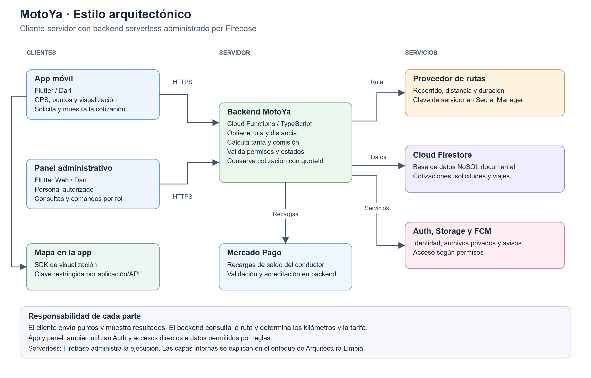

# Estilo arquitectónico: cliente-servidor

MotoYa utiliza el estilo **cliente-servidor**. La app móvil y el panel web son clientes que envían solicitudes al backend. Firebase Cloud Functions ejecuta las operaciones del servidor con infraestructura administrada, bajo un modelo **serverless**.

[Ver imagen completa](../../img/estilo-cliente-servidor-motoya.png) · [Versión SVG](../../img/estilo-cliente-servidor-motoya.svg)

| Parte | Responsabilidad |
|---|---|
| App móvil | Capturar GPS, elegir puntos, solicitar cotización, mostrar mapa y coordinar el viaje. |
| Panel web | Ejecutar consultas y comandos administrativos según rol. |
| Backend | Validar identidad y permisos, obtener recorrido y kilómetros, calcular tarifa y controlar operaciones críticas. |
| Firestore | Conservar cotizaciones, perfiles, solicitudes, viajes y movimientos. |
| Servicios administrados | Auth identifica; Storage conserva archivos; FCM permite notificar. |
| Proveedor de rutas | Responder al backend con recorrido, distancia y duración. |

La clave de consultas de rutas reside en Secret Manager y solo el backend autorizado la utiliza. La app muestra el mapa con su SDK y una clave restringida a la aplicación y a las API necesarias. El servidor acepta la oferta del pasajero dentro de los límites permitidos y usa su propia cotización como base.

App y panel también utilizan Auth y accesos directos permitidos a Firestore. El gráfico resume relaciones principales; no exige que toda lectura pase por Cloud Functions. Mercado Pago pertenece al flujo de recargas del conductor. El pago del viaje es directo entre pasajero y conductor.

## Diferencia entre estilo y enfoque

El **estilo** explica cómo se comunican las aplicaciones y los servicios. El **enfoque de Arquitectura Limpia** explica las responsabilidades y dependencias dentro de su código. El [gráfico de capas](enfoque-arquitectonico.md) corresponde al enfoque.

**Para exponer:** «La app y el panel son clientes. El backend valida las operaciones, consulta la ruta y calcula la tarifa. Firebase administra la infraestructura. Esta comunicación es cliente-servidor; la organización interna del código utiliza Arquitectura Limpia».

---

[Volver al índice](../../README.md)
