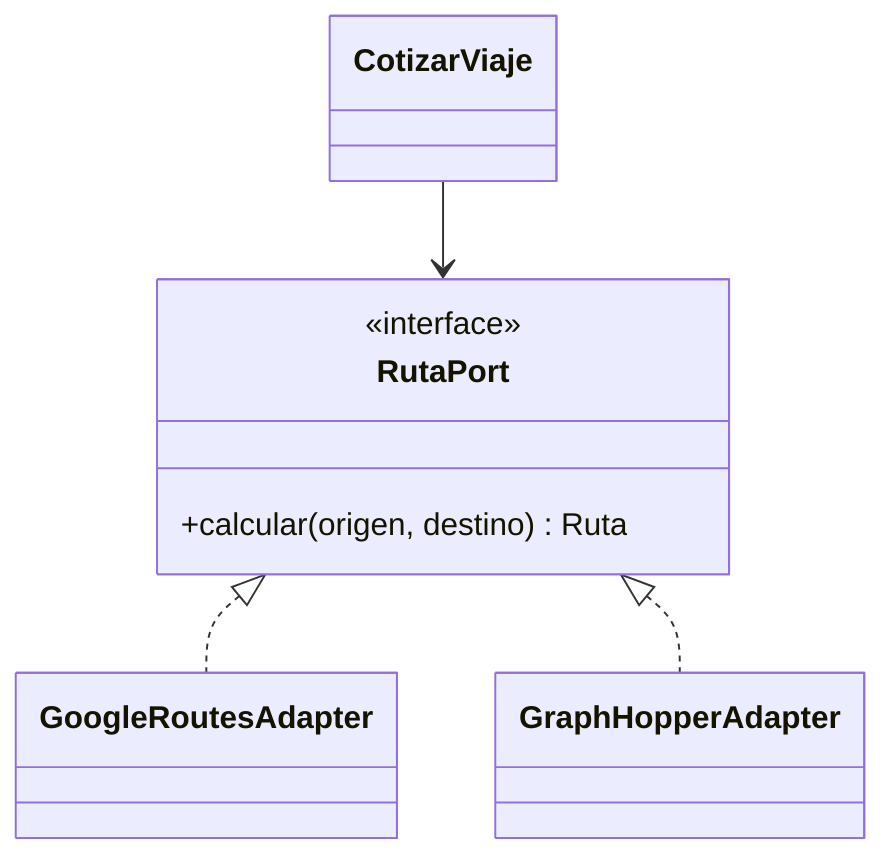

# Patrones de diseño

Los patrones se proponen cuando resuelven un problema concreto de MotoYa. No se afirma que ya estén implementados en el prototipo.

| Patrón | Aplicación | Problema resuelto | Contrato / precaución |
|---|---|---|---|
| Adapter | GoogleRoutesAdapter y GraphHopperAdapter | Diferencias de API de rutas | Devuelven distancia en metros, duración en segundos y ruta validada; un error no se convierte en ruta de 0 m |
| Repository | SolicitudRepository, ViajeRepository | Separar persistencia y dominio | No exponer DocumentSnapshot ni consultas Firebase al dominio |
| Strategy | PoliticaComisionNormal / PoliticaComisionLanzamiento | Comisión cero durante campaña | Selección por configuración de servidor congelada en el viaje |
| State | Transiciones de Viaje | Impedir inicio sin PIN o cierre de viaje cancelado | Tabla de transiciones y guardas ejecutadas por servidor |
| Observer / publicación de eventos | ViajeAsignado, ViajeFinalizado y SOSCreado | Actualizar pantallas y avisar | Consumidores idempotentes; evento persistido antes de notificar |
| Facade | ServicioDespacho | Coordinar elegibilidad, rutas y ofertas | API acotada; no convertirla en clase con todo el negocio |
| Transactional Outbox | Notificación posterior al commit | Evitar pérdida de avisos entre escritura y envío | Estado pendiente, intento, próximo reintento e identificador único |

## Ejemplo: sustitución de proveedor de rutas

Si Google falla, la política de resiliencia intenta el respaldo solo si está configurado y sano. Ambos adaptadores deben cumplir el mismo contrato. Una línea recta informativa no satisface `Ruta` para cotizar un viaje real.

## Lo que no se agrega todavía

No se incorpora Redis, un bus de eventos externo ni microservicios solo para demostrar patrones. El outbox puede residir en Firestore y su consumidor en Cloud Functions; cualquier cambio de tecnología debe responder a una necesidad medida.
