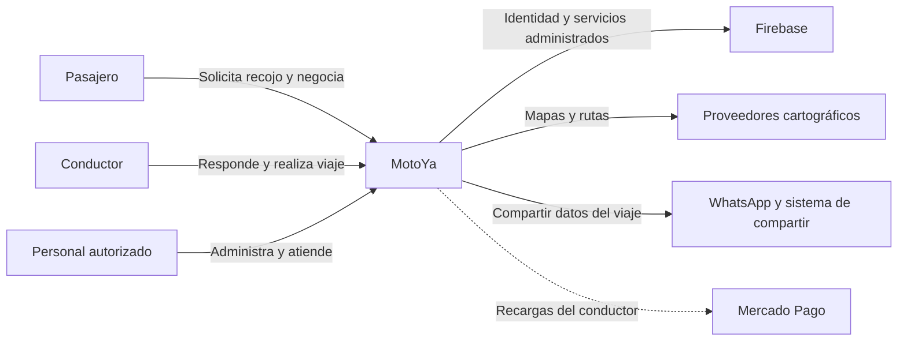

# Nivel 1: contexto del sistema

**Pregunta:** ¿quién usa MotoYa y con qué sistemas externos se relaciona?

| Elemento | Tipo | Relación con MotoYa |
|---|---|---|
| Pasajero | Persona | Solicita, negocia y realiza viajes. |
| Conductor | Persona | Responde y presta el servicio. |
| Personal autorizado | Persona | Revisa y administra desde panel. |
| MotoYa | Sistema | Coordina solicitudes, viajes y operación. |
| Firebase | Plataforma externa | Aporta identidad, datos, archivos, funciones y avisos según configuración. |
| Proveedores cartográficos | Sistemas externos | Proporcionan mapas, lugares y rutas. |
| WhatsApp / mecanismo de compartir | Sistema externo | Permite comunicar datos del viaje. |
| Mercado Pago | Integración externa de recarga | Procesa recargas de saldo del conductor. |

No se incluye al proveedor como autoridad que decide reglas de negocio. El pago del viaje permanece entre pasajero y conductor.

---

[Volver al índice](../../README.md)

## Diagrama

