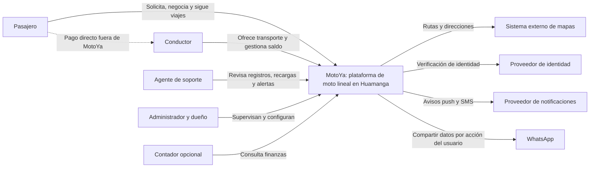

# C4 - Nivel 1: contexto del sistema

**Alcance:** MotoYa como sistema completo. **Audiencia:** docente, responsables del negocio y usuarios. Las personas son actores; los bloques externos representan dependencias, sin detallar tecnologías internas.

## Interpretación

MotoYa registra la relación entre pasajero, conductor y viaje. El pago directo queda fuera de su frontera: efectivo, Yape y Plin son medios elegidos por las personas, no integraciones de cobro automático del sistema. La recarga del conductor se acredita después de verificación humana por soporte.

El botón de emergencia facilita comunicación y crea una alerta, pero MotoYa no representa a los servicios de emergencia ni garantiza su intervención. La atención de soporte requiere personal disponible.

**Siguiente vista:** [contenedores](nivel2-contenedores.md).
