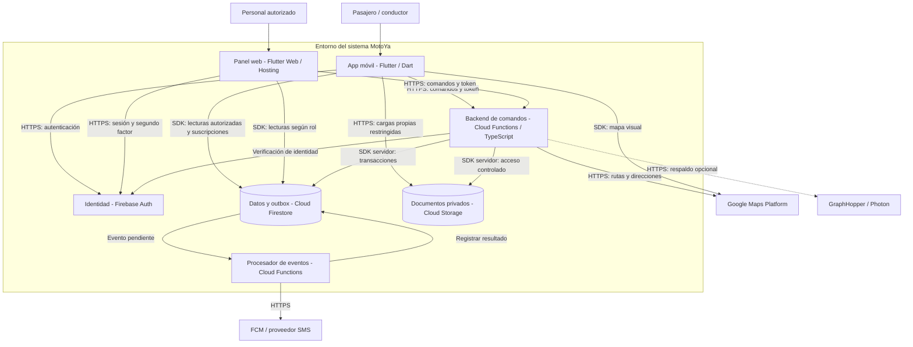

# C4 - Nivel 2: contenedores

**Alcance:** unidades de ejecución y almacenamiento de MotoYa. En C4, contenedor no significa necesariamente Docker. **Audiencia:** equipo de desarrollo y operación.

## Responsabilidades y despliegue

- **Móvil:** Android primero, modos pasajero/conductor y ubicación; almacena solo lo necesario para recuperar la experiencia.
- **Panel:** interfaz separada con roles, segundo factor y auditoría; dominio de publicación propuesto `admin.motoya.pe`, sin afirmar que esté desplegado.
- **Backend:** autoridad sobre reglas críticas y control de acceso; funciones organizadas en módulos.
- **Datos:** Firestore conserva estados y registros; Storage conserva archivos privados, evitando incrustarlos en documentos.
- **Procesador:** reintenta entrega de avisos; el estado de negocio permanece en el backend.

Desarrollo y producción usarán proyectos separados. Los secretos de servicios externos se almacenarán fuera del repositorio. El respaldo de mapas agrega infraestructura propia y requiere monitoreo, datos actualizados y mantenimiento antes de activarse.

**Anterior:** [contexto](nivel1-contexto.md). **Siguiente:** [componentes](nivel3-componentes.md).
