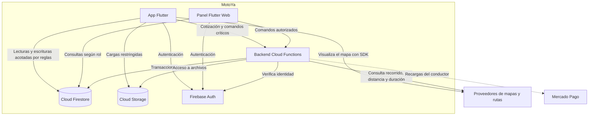

# Nivel 2: contenedores

**Pregunta:** ¿qué aplicaciones y servicios ejecutan la solución?

| Contenedor | Tecnología | Responsabilidad | Comunicación |
|---|---|---|---|
| App móvil | Flutter / Dart | Interfaz de pasajero y conductor | Auth, lecturas autorizadas, funciones, mapas y rutas. |
| Panel web | Flutter Web | Operación interna | Auth, consultas y comandos autorizados. |
| Backend | Cloud Functions / TypeScript | Cotizaciones, comandos y reglas críticas | Auth, Firestore, Storage y servicios externos. |
| Base de datos | Cloud Firestore | Estados, perfiles y movimientos | SDK cliente bajo reglas y SDK servidor con autorización propia. |
| Almacenamiento | Cloud Storage | Documentos y comprobantes | Cargas y lecturas restringidas. |
| Identidad | Firebase Auth | Sesión y verificación | App, panel y validación del backend. |

Un contenedor C4 no equivale necesariamente a Docker. El despliegue mantiene entornos separados para pruebas y operación.

---

[Volver al índice](../../README.md)

## Diagrama

