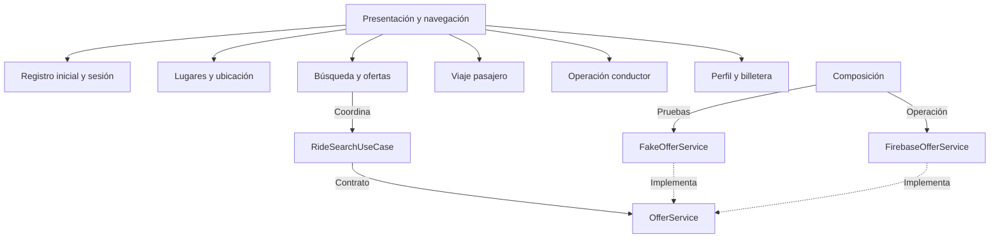

# Nivel 3: componentes de la app

**Contenedor ampliado:** app móvil. **Pregunta:** ¿qué componentes colaboran en su interior?

| Componente | Responsabilidad | Colabora con |
|---|---|---|
| Registro inicial y sesión | Acceso y recuperación del perfil | Contratos de identidad y sus adaptadores. |
| Lugares | Ubicación, búsqueda y visualización de cotización | GPS, mapa y contrato de cotización del backend. |
| Búsqueda y ofertas | Negociación y aceptación | RideSearchUseCase, OfferService. |
| Viaje pasajero | Seguimiento y acciones del pasajero | Servicios de viaje y seguridad. |
| Operación conductor | Disponibilidad, solicitudes y viaje | Ubicación, presencia y servicios del conductor. |
| Perfil y billetera | Datos, saldo, movimientos y recargas | Contratos y adaptadores correspondientes. |
| Composición | Construcción de dependencias | Providers y configuración de entorno. |

El siguiente nivel amplía Búsqueda y ofertas, manteniendo continuidad entre las vistas.

---

[Volver al índice](../../README.md)

## Diagrama

