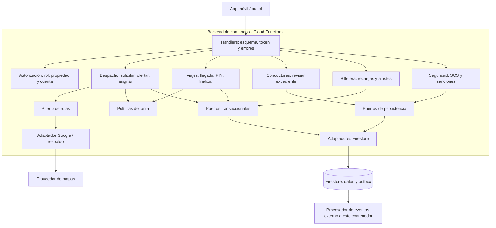

# C4 - Nivel 3: componentes del backend de comandos

**Contenedor ampliado:** backend Cloud Functions del nivel 2. **Audiencia:** desarrolladores del backend. Los módulos de interfaz móvil quedan fuera de esta ampliación.

Las flechas expresan colaboración en ejecución; la implementación de los adaptadores depende de las interfaces de dominio. Todos los handlers aplican autorización antes de ejecutar casos de uso. Las verificaciones de estado y disponibilidad se repiten dentro de la transacción para evitar carreras.

| Caso de uso | Colaboraciones | Límite consistente |
|---|---|---|
| AceptarOferta | Despacho, elegibilidad y billetera | Oferta, solicitud, viaje, participantes y reserva |
| FinalizarViaje | Viajes y política de comisión | Viaje, movimiento, reserva, saldo y outbox |
| ConfirmarRecarga | Billetera y autorización de panel | Recarga, comprobante único, movimiento, saldo y auditoría |
| ActivarSOS | Seguridad y datos mínimos del viaje | Alerta y evento de aviso |

Una búsqueda geográfica previa reduce candidatos, pero no asegura disponibilidad al asignar: la transacción vuelve a comprobarla. La vista de reportes puede estar retrasada; no se utiliza para autorizar gasto de saldo.

**Anterior:** [contenedores](nivel2-contenedores.md). **Siguiente:** [código](nivel4-codigo.md).
