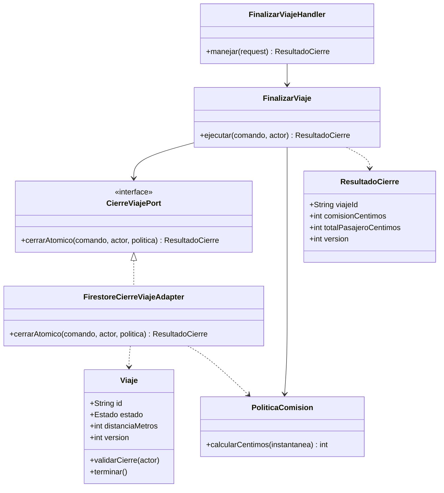
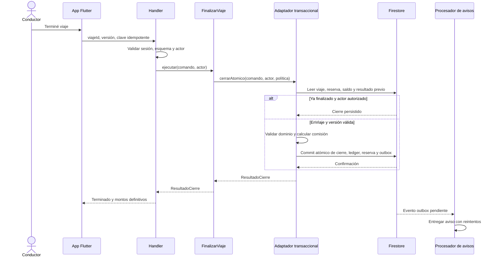

# C4 - Nivel 4: diseño de código de FinalizarViaje

**Componente ampliado:** Viajes, dentro del backend. Este nivel describe clases y contratos propuestos, no clases verificadas en el código de la app. Se complementa con una secuencia de ejecución.

## Clases



## Secuencia: finalizar sin duplicar comisión



## Contrato ilustrativo

```typescript
// Pseudocontrato: nombres y tipos para guiar la implementación.
interface FinalizarViajeCommand {
  viajeId: string;
  expectedVersion: number;
  idempotencyKey: string;
}
interface ResultadoCierre {
  viajeId: string;
  estado: 'Terminado';
  comisionCentimos: number;
  totalPasajeroCentimos: number;
  version: number;
}
interface CierreViajePort {
  cerrarAtomico(
    cmd: FinalizarViajeCommand,
    actorId: string,
    politica: PoliticaComision
  ): Promise<ResultadoCierre>;
}
```

El adaptador debe usar la entidad y política dentro del cierre transaccional, con datos leídos de forma consistente. Un método genérico `guardar(viaje)` por sí solo no cubre la atomicidad entre viaje, saldo y ledger. El procesamiento de avisos nunca vuelve a ejecutar el débito.

**Anterior:** [componentes](nivel3-componentes.md).
