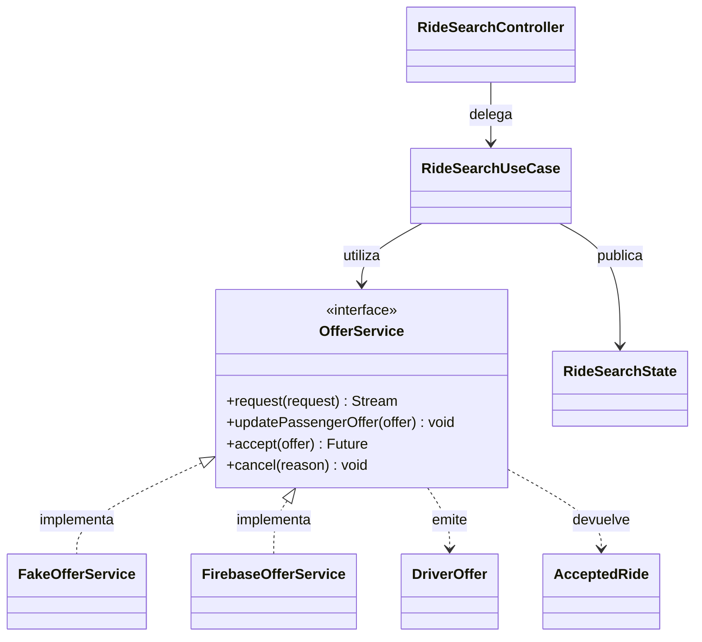
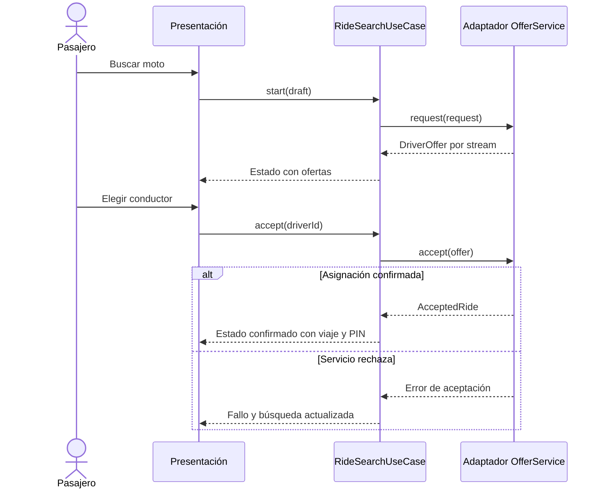

# Nivel 4: código de búsqueda y ofertas

**Pregunta:** ¿qué clases e interfaces concretas implementan el componente?

| Pieza | Tipo | Relación |
|---|---|---|
| RideSearchController | Controlador de presentación | Utiliza RideSearchUseCase. |
| RideSearchUseCase | Caso de uso | Depende de OfferService y publica RideSearchState. |
| OfferService | Interfaz del dominio | Declara request, updatePassengerOffer, accept y cancel. |
| FakeOfferService | Adaptador simulado | Implementa OfferService. |
| FirebaseOfferService | Adaptador externo | Implementa OfferService. |
| DriverOffer | Modelo | Representa una oferta de conductor. |
| AcceptedRide | Modelo | Contiene identificador de viaje y PIN. |

### Diagrama UML de clases — fuente Mermaid

### Diagrama de secuencia — fuente Mermaid

Las dos fuentes Mermaid se visualizarán directamente en GitHub. La línea continua con flecha indica uso; la discontinua con triángulo indica implementación de una interfaz. La secuencia muestra colaboración en ejecución, no imports.

---

[Volver al índice](../../README.md)
