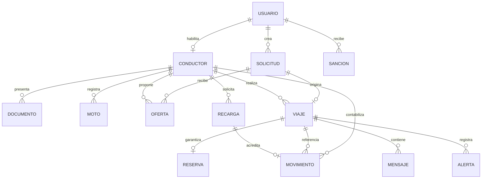
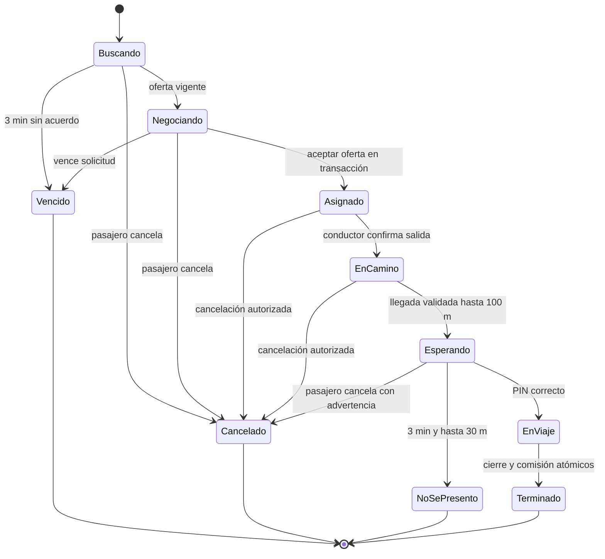

# Modelo de datos y estados

## Modelo conceptual del núcleo

La relación viaje-movimiento permite ajustes posteriores identificados, pero solo un débito base de comisión. La relación solicitud-viaje es 0..1. Una moto registrada no implica que pueda estar activa junto a otra: se define una moto aprobada activa por conductor para el MVP.

## Diccionario de almacenamiento propuesto

| Colección / entidad | Campos relevantes | Restricción |
|---|---|---|
| usuarios | uid, celularVerificado, nombre, aliasNormalizado, avatarId, estado, modo | Alias y celular únicos por registros de reserva, no por búsqueda previa |
| conductores | uid, estadoRegistro, motoActivaId, saldoCentimos, reservaCentimos | Sin escritura financiera directa del cliente |
| motos / documentos | conductorId, placa, tipo, storagePath, venceEn, version, estado | Archivos privados; no publicar DNI o enlaces permanentes |
| cotizaciones | origen, destino, ruta, distanciaMetros, proveedor, configVersion, venceEn | Calculada por servidor; copia inmutable al asignar |
| solicitudes | pasajeroId, cotizacionId, ofertaCentimos, versionOferta, estado, venceEn | Un bloqueo activo por pasajero |
| ofertas | solicitudId, conductorId, versionOferta, precioCentimos, venceEn, estado | Una respuesta por conductor y versión de oferta |
| viajes | solicitudId, pasajeroId, conductorId, estado, version, precioCentimos, instantaneaTarifa, llegoEn, inicioEn, finEn | Una asignación por solicitud; estado autoritativo |
| secretosViaje | viajeId, pinProtegido, intentos, bloqueado | Acceso separado; conductor nunca puede leer PIN; verificación solo servidor |
| reservas | viajeId, conductorId, montoCentimos, estado | ID determinista por viaje; saldo disponible no negativo |
| movimientos | conductorId, tipo, montoFirmadoCentimos, viajeId, recargaId, creadoEn | Solo servidor; inmutable; correcciones con contramovimiento |
| recargas | conductorId, montoCentimos, proveedor, referencia, capturaPath, estado, revisadoPor | Una identidad de comprobante acreditada una sola vez |
| alertas / casos | viajeId, actorId, ubicacion, creadaEn, estado, agenteId, resultado | No borrable desde panel; escalamiento a 2 min |
| mensajes | viajeId, autorId, tipo, texto, creadoEn | Participantes; soporte con caso; retención de 90 días |
| sanciones | usuarioId, tipo, motivo, evidencia, inicio, fin, estado, apelacion | Afecta ambos modos; revisión independiente |
| auditoria | actorId, accion, entidadId, antes, despues, motivo, fecha | Escritura por servidor; lectura por permiso |
| outbox / operaciones | eventId o clave, payloadMinimo, estado, intentos, resultado | Dedupe y reintentos; no almacenar secretos |
| configuraciones | version, vigencia, tarifa, comision, radios, campaña, espera | Autor, motivo y fecha; viaje conserva su versión |

Entidades auxiliares: contactos de emergencia (hasta 3 por pasajero), reseñas (única por viaje/autor), reclamos, sugerencias, cuentas del panel, gastos y registros de bloqueo. No se incorpora el campo sexo para el registro de conductor: la preferencia por conductora está retirada.

## Proyección física y consultas

Usar subcolecciones para mensajes, posiciones históricas y eventos; evitar arreglos crecientes dentro de Viaje. Separar posición actual del historial. Proponer índices compuestos para solicitudes por zona/estado/vencimiento, ofertas por solicitud/estado, recargas por estado/fecha y viajes por participante/fecha. Las consultas geohash necesitan eliminar duplicados y filtrar distancia exacta.

La posición aproximada pública del conductor libre se separa de la ubicación exacta. Solo participantes del viaje y personal autorizado por caso reciben ubicación precisa. Los datos privados no comparten un documento legible públicamente, porque ocultar campos en la interfaz no los protege.

## Máquina de estados

Buscando, Negociando y Vencido pertenecen a Solicitud; el agregado Viaje nace al asignarse. La vista unifica ambos para explicar el recorrido del usuario. Una emergencia durante EnViaje crea un caso; no fuerza una transición financiera automática. Su resolución excepcional requiere protocolo de soporte.

## Retención propuesta

Chat: 90 días. Recorrido detallado: 12 meses. Auditoría y metadatos esenciales de viajes, recargas y alertas: 2 años. Respaldos: 30 días. La eliminación de cuenta desacopla el perfil de los registros sujetos a conservación, con acceso restringido y justificación documentada. Los plazos deben validarse antes del lanzamiento; este diseño no acredita cumplimiento legal.
